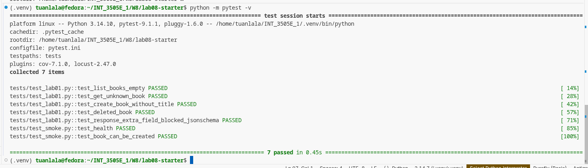
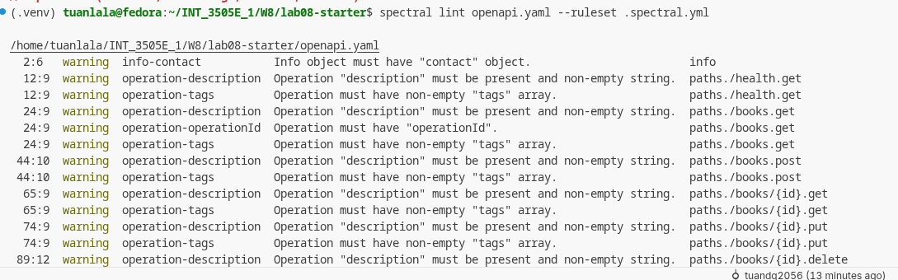
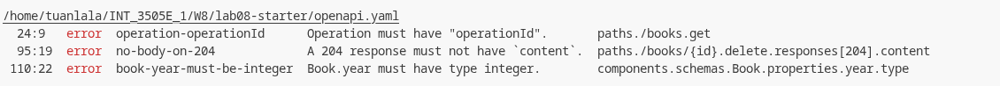
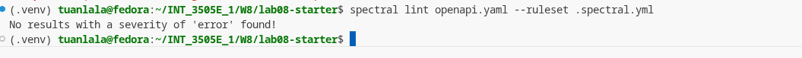
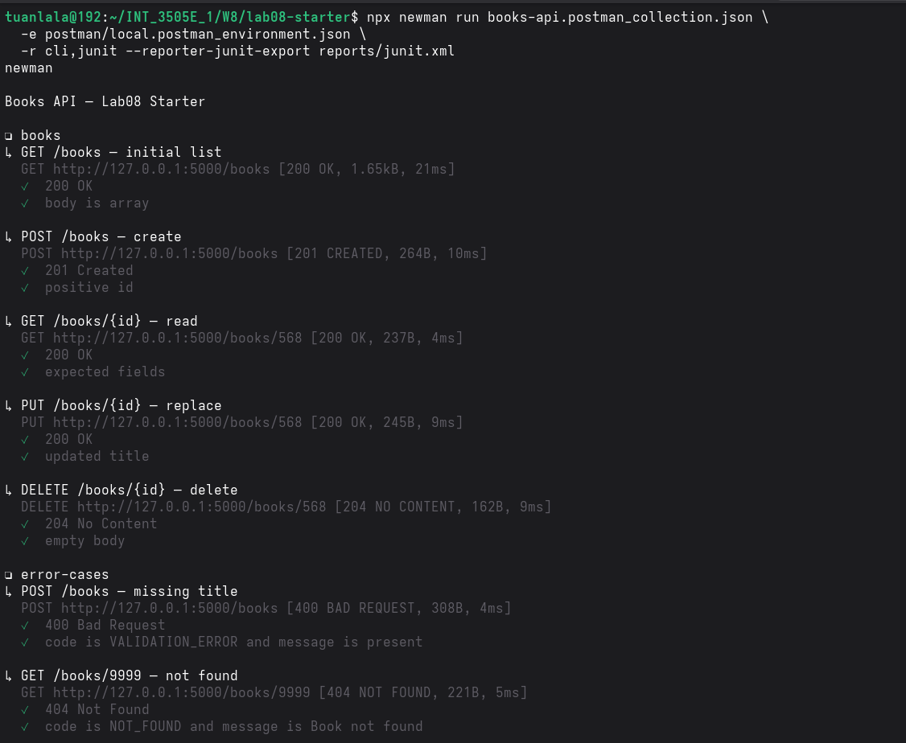
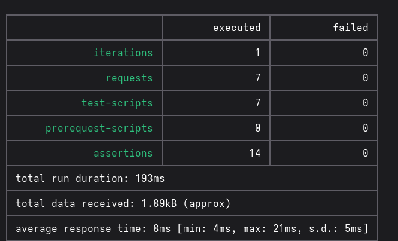
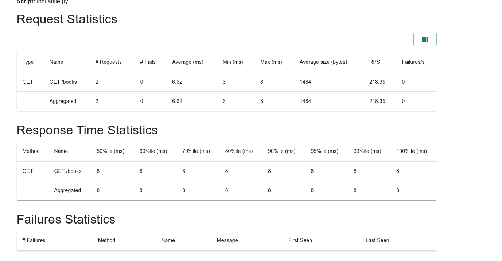
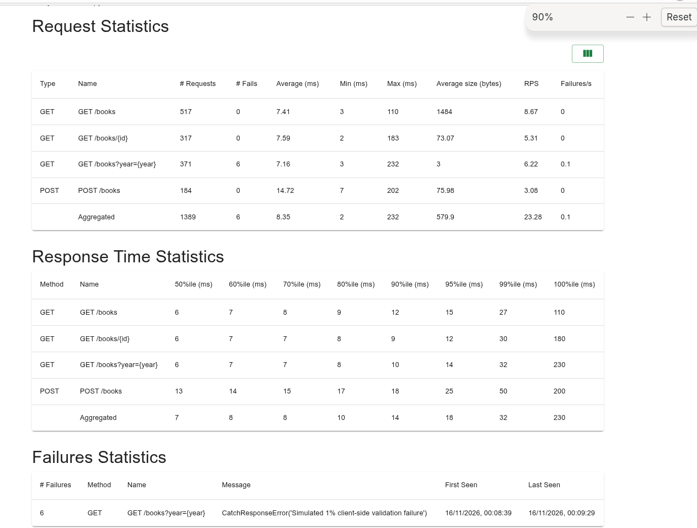
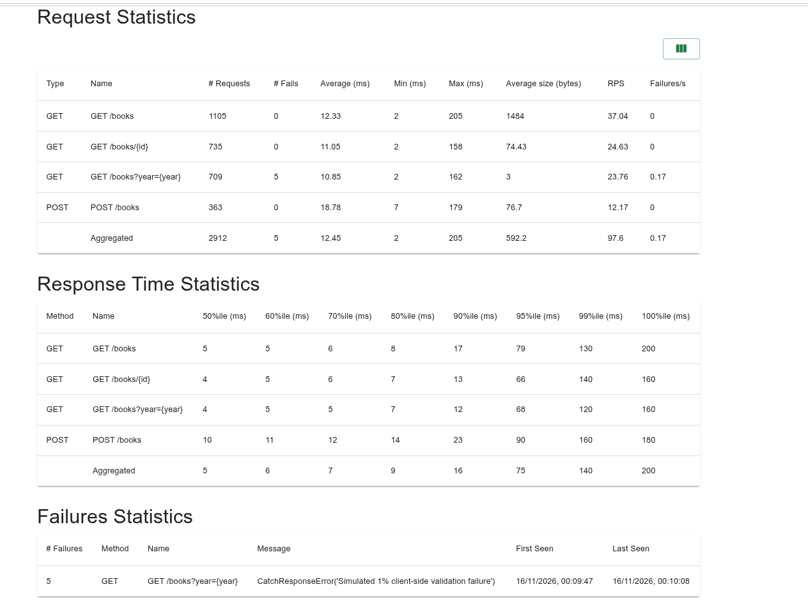

Kết quả test lab1:

kết quả lab2: 
spectral không có rule :bắt được operation ID : 

sau khi thêm rulseset: 

sau khi sửa : 

Kết quả lab3 :

Kết quả lab 4 , tương ứng với A,B và C theo thứ tự :

